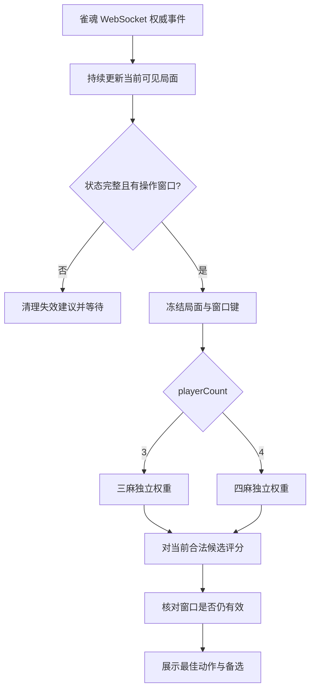

# 雀魂牌谱策略模型

第一版实现了「官方格式牌谱 → 可见局面与动作标签 → 监督训练 → 模型导出 → 离线推理 → 可选客户端接入」。它学习牌谱玩家在合法动作之间的选择。输出的 `policyProbability` 是候选动作之间的偏好分布，不是和牌率、胜率或动作最优性的证明。

当前实现包括官方格式牌谱的 **smoke 样例模型**，以及 [MJAI 转换和按场流式训练](policy-mjai.md)。前者返回 `status: analysis`，现有自动打牌入口不会执行该模型的建议；后者使用公开雀魂王座之间四麻和天凤凤桌三麻，分别生成独立的监督模仿权重。原始完整 MJAI 各有 50,000 场；过滤后固定采用四麻 **49,951 场、29,809,311 条样本**和三麻 **47,063 场、14,887,401 条样本**。两套完整语料均已转换成功，MPS 各 3 轮训练已启动；最终留出成绩和导出验收尚未完成。下文保留的四麻 200 场、三麻 500 场结果是历史管线实验。

## 模型与动作

结构参考 [Akagi v3 原生模型](https://github.com/shinkuan/Akagi/tree/cd68865f9e93eddcda6451cd18874a6f68c5fb49)，采用 64 通道卷积、3 个残差块和 256 维隐藏层。本项目独立实现可变数量的候选动作评分，不导入 Akagi 权重。

| 部分 | 当前实现 |
| --- | --- |
| 牌面输入 | `54 × 34`：手牌张数、红牌、摸牌、宝牌指示牌、已见及未见张数、各家牌河与副露摘要 |
| 全局输入 | 56 维：相对座位、点数、庄家、场风、立直与待确认立直、拔北、剩余牌数、本场、供托、振听及信息是否已知等 |
| 动作输入 | 每个候选 134 维：动作类型、具体牌、被鸣牌、消耗牌、来源座位、副露索引、手切／摸切 |
| 输出 | 每个合法候选一个分数，在该窗口的合法候选上做 softmax |
| 参数量 | 756,545 |
| 训练 | PyTorch；交叉熵、AdamW、梯度裁剪；按验证集 NLL 选择权重 |
| 部署 | NumPy CPU；非 pickle 的 `.npz`，加载时检查版本、特征签名、玩法、形状和有限数值 |
| 玩法 | 三麻、四麻独立训练、独立加载；仅普通段位规则 |

支持出牌、立直、吃、碰、大明杠、暗杠、加杠、拔北、自摸、荣和、九种九牌流局以及跳过，共 12 种语义动作。红五与普通五分别编码；同牌手切与摸切也分别建候选。吃碰杠保留消耗牌，不能仅输出一个操作类别。

`policy_actions.legal_actions(state)` 从操作列表生成完整候选，不预先裁掉和牌、跳过或低启发式分数的动作。不完整、矛盾或过期的操作窗口会拒绝推荐。官方格式提取器要求记录中的服务端操作列表；MJAI 转换器使用固定版本的规则引擎重建操作列表，并明确标记为 `riichienv-reconstructed`。两条路径的牌谱标签都必须恰好对应一个合法候选；不能根据实际发生的动作向候选集合补入标签。

官方格式输入采用与实时客户端相同的 `core.cjs` 状态更新，MJAI 则投影到同一可见局面契约。回放逐座位投影，模型只读白名单字段：不会使用对手暗手、对手摸牌、牌山、里宝牌、未来事件、最终排名、账号或昵称。牌河时序在此版以计数和最新位置摘要表示，没有完整序列编码器，也没有价值网络或强化学习训练。

## Akagi 对照与固定训练目标

本次重新核对 Akagi v3 的固定提交 `cd68865f9e93eddcda6451cd18874a6f68c5fb49`。其 [native bot 训练器](https://github.com/shinkuan/Akagi/blob/cd68865f9e93eddcda6451cd18874a6f68c5fb49/native_bot/train/train.py#L178-L205)同样使用合法动作内的交叉熵，[牌谱回放](https://github.com/shinkuan/Akagi/blob/cd68865f9e93eddcda6451cd18874a6f68c5fb49/native_bot/src/replay.rs#L75-L164)覆盖出牌、立直、吃碰、三类杠、和牌和拔北，快照取在动作之前。

训练目标固定为 **当前可见局面 → 高段位玩家实际选择的动作**。三麻和四麻共享编码与网络实现，但语料、整场数据划分、训练参数、评估报告和权重文件各自独立。三麻不产生吃的候选，四麻不产生拔北的候选；每份模型元信息绑定 `playerCount`，装错槽位会报错。

损失为 `-log P(真实动作 | 当前可见局面, 合法候选)`。当前点数仍可作为局面输入；终局收益、排名和价值预测不进入监督目标。以整场留出的动作 Top-1、Top-3、选择窗口 NLL、各动作支持数量及准确率评价拟合，再单独测实时建议合法性和延迟。

保留本项目的几项设计：

- Akagi 的 [动作编号](https://github.com/shinkuan/Akagi/blob/cd68865f9e93eddcda6451cd18874a6f68c5fb49/native_bot/src/action_codec.rs#L56-L100)合并部分红牌选择；本项目输出完整候选，保留红牌、消耗牌、来源和手切／摸切。
- Akagi 的 [训练划分](https://github.com/shinkuan/Akagi/blob/cd68865f9e93eddcda6451cd18874a6f68c5fb49/native_bot/train/train.py#L151-L159)按决策行随机分组；本项目同一场的所有小局和座位始终放在同一集合。
- 成功的吃碰杠不证明其他玩家主动跳过了低优先级选择；只从无歧义的窗口关闭生成 `pass`，竞争响应保守排除。
- Akagi 的 [实时事件白名单](https://github.com/shinkuan/Akagi/blob/cd68865f9e93eddcda6451cd18874a6f68c5fb49/src/bot/manager.rs#L701-L719)不能代替雀魂权威操作列表。本项目以实际 `operationDetails` 为准，包含服务端开放的抢暗杠和抢北窗口。

这些差异不要求改用 Rust、代理或独立 bot 进程。现有牌局监听、可见状态、后台推理和浮层可直接复用。详细源码对照保存在 `.local/high-rank-50k/research/akagi-design/report.md`。

## 实时建议的事件流程



所有牌局事件都更新状态，只有决策窗口请求模型建议。典型窗口包括庄家开局出牌、本人摸牌、他家弃牌后的吃碰杠／荣和、吃碰后的出牌、杠或拔北后的补牌，以及服务端实际允许的抢杠／抢北。拔北或杠动作已确认但尚未补牌时，等待新的权威操作窗口。

`PolicyAdvisor` 启动时加载两套权重，按 `state.playerCount` 路由。`policy_actions.legal_actions` 从当前操作列表生成完整候选；模型只排序这些候选。样本提取与实时推理共用 `policy_features` 和 `policy_actions`，训练标签必须恰好匹配候选，不能通过补入实际动作来伪造合法集合。

`AdviceWorker` 保存快照并在后台推理，新请求覆盖排队的旧请求。结果携带 `adviceKey`，新事件或窗口关闭会使旧结果失效。展示给用户的是动作、具体牌／鸣牌组合、备选动作、模仿偏好和耗时；模型建议不会推测性修改当前游戏状态。例如“建议立直”只是包含具体弃牌的候选，必须等游戏权威事件才更新立直状态。

浮层还会核对当前操作的服务端时限。即使下一条事件尚未到达、`adviceKey` 没有改变，超时返回的建议也不会显示为可操作；已经显示的建议在截止时主动清除。新窗口、新结果、页面退出和状态失效均取消旧计时器。

界面显示与动作执行分层：建议可供用户手动操作；执行入口继续重新核对当前窗口、候选参数，并等待 RPC ACK 和权威动作回显。参考 Akagi 不改变现有重复提交保护。重连恢复中暂停推荐，恢复完整状态后基于最后一个当前窗口生成建议，不能逐个执行历史窗口。

## 固定语料全量训练（2026-10-13）

训练目标与候选编码保持不变。按用户要求，本轮只使用已筛选的公开来源，不从额外本地牌谱、已下载数据库或归档继续补量，也不混入个人牌谱或应用录制会话。原始两份 50,000 场清单保留不变，“全量”指下表全部合格对局参与固定的训练／验证／测试流程，不表示把验证或测试样本用于梯度更新。

| 项目 | 三麻 | 四麻 |
| --- | ---: | ---: |
| 固定合格对局 | 47,063 | 49,951 |
| 已转换监督样本 | 14,887,401 | 29,809,311 |
| 训练 / 验证 / 测试场数 | 37,651 / 4,706 / 4,706 | 39,961 / 4,995 / 4,995 |
| 直接记录动作 / 推断跳过 | 13,882,622 / 1,004,779 | 24,689,674 / 5,119,637 |
| 整场转换失败 | 0 | 0 |
| 本轮训练配置 | MPS，3 轮，batch 2,048，game window 16 | MPS，3 轮，batch 2,048，game window 16 |
| 最终模型及测试状态 | 训练进行中，待最终评估与导出核验 | 训练进行中，待最终评估与导出核验 |

三麻排除 1,000 个转换器开发场、3 个真实回归 fixture，以及 1,934 个额外含 `BYE` 的场次，排除并集为 2,937 场；所有含 `BYE` 的场次共 1,965 场，其中 31 场已在开发集合内。500 场 pilot 的 400 / 50 / 50 分区全部保留。四麻沿用已冻结的 49,951 场分区和 49 个开发场排除；此前 200 场 pilot 全部来自正式 train 集合，其内部验证／测试仅作开发测量，未污染正式留出集合。

训练使用按源文件和编码器签名绑定的无损特征缓存，最多把 16 场训练样本合并后打乱组成 batch，内存不随总场数增长。新增优化器断点保存模型、AdamW 状态、随机数状态、当前轮次／场游标和历史验证结果；`--resume` 必须匹配原来源、固定划分、编码器、训练器及训练参数。具体 MPS、缓存准备和恢复命令见 [全量训练操作](policy-mjai.md#固定语料全量转换与-mps-训练)。

本轮源审计在 `.local/high-rank-50k/four-player-full/source-audit.json`、`three-player-full/source-audit.json`；转换报告分别为 `.local/high-rank-50k/training/report.json`、`three-player-full/training/report.json`。训练日志在 `research/full-training/four-player-training.log`、`three-player-training.log`。最终 Top-1／Top-3、NLL、逐动作成绩、权重哈希和导出一致性只能在最终 `.report.json` 生成后填写，不能从训练进度日志或历史 pilot 成绩代替。

## 历史双模型小规模训练与实时验收（2026-10-13）

本轮三麻从已取得的 50,000 场完整 MJAI 中排除 1,000 场转换器开发记录，再选取 500 场提取样本。18 场含断线 `BYE` 的记录被整场排除后补足目标；三场新增真实回归 fixture 均未进入这 500 场。四麻沿用此前 200 场实验权重，本轮对同一批原谱重新转换，逐一核对 125,665 个决策的可见状态、标签、合法候选、标签索引以及全部编码特征，差异为 0；仅增加来源审计字段。

| 项目 | 三麻 | 四麻 |
| --- | ---: | ---: |
| 来源 | 天凤凤桌，原始段位七段至天凤位 | 雀魂王座之间，依据发布者归档分类 |
| 实验完整对局数 | 500 | 200 |
| 样本总数 | 161,180 | 125,665 |
| 训练 / 验证 / 测试场数 | 400 / 50 / 50 | 160 / 20 / 20 |
| CPU 训练轮数 | 2 | 1 |
| 训练和最终评估耗时 | 288.72 s | 147.48 s |
| 实验内部测试集动作 Top-1 | 46.58% | 54.62% |
| 实验内部测试集动作 Top-3 | 74.86% | 77.00% |
| 实验内部测试集 NLL | 1.56162 | 1.36853 |
| PyTorch / NumPy 导出核对 | 32 个窗口首选全一致，最大误差 `1.43e-6` | 32 个窗口首选全一致，最大误差 `5.96e-7` |

这些指标是各自实验的整场留出结果，不是 50,000 场正式测试成绩，也不宜用来比较三麻与四麻棋力。三麻测试集拔北匹配为 1,105 / 1,110，但立直仅 47 / 289，加杠 0 / 15；四麻吃为 0 / 166。两份权重仍明显欠拟合稀有或复杂动作，当前作用是验证数据、训练、导出和实时接口。

新增二进制 `ActionPrototype` 回放经过实际浏览器监听和状态核心，覆盖全部 12 类动作、双模型路由、碰吃后的出牌、杠和拔北后的补牌、抢暗杠／抢北响应，以及旧推理结果被新窗口淘汰。36 个确定性模型到动作提交用例继续核验 RPC 参数、ACK 和权威回显。回归结果为 Python 189 项通过、4 项因可选本地牌谱缓存缺失跳过，Node 195 项通过。

使用这两份真实权重，对三麻 18 个、四麻 16 个可行动窗口分别重复 20 次，测得：

| 离线耗时 | 三麻 | 四麻 |
| --- | ---: | ---: |
| 候选生成 + 特征编码 + 推理，中位 / P95 | 0.338 / 0.372 ms | 0.327 / 0.355 ms |
| 后台排队 + 计算 + 取回，P95 | 0.452 ms | 0.423 ms |
| 再加界面更新脚本生成，P95 | 0.483 ms | 0.445 ms |

计时从已有可见状态开始，不包括线帧解析、WebKit 执行、网络或原生主线程每 50 ms 的派发等待，不能宣称真实端到端延迟低于 1 ms。真实在线牌局和原生 GUI 展示仍未验收。`policy_launch.py --check` 已确认两套权重、玩法槽位、特征签名和源码运行依赖可加载，检查本身不启动 App。

三麻训练及双模型检查可复现为：

```sh
cd /Users/kenny/Desktop/Maj-Soul-PlusPlus-training-20261013
/Users/kenny/Desktop/Maj-Soul-PlusPlus-model/.venv/bin/python scripts/policy_train_corpus.py \
  --manifest .local/high-rank-50k/three-player-pilot-training/manifest.jsonl \
  --players 3 --epochs 2 --batch-size 128 --threads 2 --device cpu \
  --output .local/high-rank-50k/models/three-player-pilot.npz

/Users/kenny/Desktop/Maj-Soul-PlusPlus-model/.venv/bin/python scripts/policy_launch.py \
  --three-player .local/high-rank-50k/models/three-player-pilot.npz \
  --four-player .local/high-rank-50k/models/four-player-pilot.npz --check
```

权重 SHA256 分别为三麻 `63435f5673dc61628c370725f9146536bd1e5b23bbd4075e4dc15bad94809710`、四麻 `a5d6b4b7c529a0f181a9fe459a07ed803a61c57b485dbc79455a55b33e6feef4`。完整模型报告与权重同目录；来源、代码与输出哈希、逐动作成绩、四麻差分、实时延迟和测试范围保存在 [双模型验收汇总](benchmarks/policy-dual-model-20261013.json)。

离线 MJAI 样本仍排除杠后的小局后续窗口及潜在抢北后续窗口。天凤与雀魂规则不完全相同，当前三麻模型也没有雀魂国士抢暗杠的训练正例；实时服务端候选能保证模型只选择当前允许的动作，却不能保证未充分训练的动作具有好的推荐质量。平台和源规则字段用于审计，不直接进入网络；未来增加其他来源须逐项核验规则兼容性，不能只凭共同的特征版本字符串混入。具体来源与过滤边界见 [跨平台调查](policy-cross-platform-data.md)。

## 安装与复现样例

在仓库根目录执行。需要 Python 3.12 和 Node.js 18+；训练依赖与应用依赖分开安装。

```sh
python3.12 -m venv .venv
.venv/bin/python -m pip install -r requirements-training.txt

# 下载固定版本、固定哈希的一场公开牌谱。
.venv/bin/python scripts/policy_fetch.py \
  --public-sample four-player-210815 \
  --output .local/policy-data/public-four-player.normalized.json

# 抽取各座位在当时可见的局面、动作及排除原因。
node scripts/policy_extract.cjs \
  .local/policy-data/public-four-player.normalized.json \
  --output .local/policy-data/four-player.samples.jsonl \
  --audit .local/policy-data/four-player.audit.json

# 单场只用于管线验证；必须显式选择 --smoke。
.venv/bin/python scripts/policy_train.py \
  .local/policy-data/four-player.samples.jsonl \
  --players 4 --epochs 10 --device cpu --threads 2 --smoke \
  --output .local/policy-models/four-player-smoke.npz

# 对第一个决策窗口推理；--line 可选择其他窗口。
.venv/bin/python scripts/policy_predict.py \
  .local/policy-models/four-player-smoke.npz \
  .local/policy-data/four-player.samples.jsonl --line 1
```

预测输出包含 `best`、所有排序后的 `candidates`、稳定的 `actionId`、`policyProbability`、模型哈希和耗时。也可以传入单个可见局面的 JSON，而非样本 JSONL。

数据由第三方公开仓库保存，内容是雀魂官方牌谱格式；不是雀魂官方发布的训练数据集。下载地址、版权说明、哈希、二进制导入和 `--head-json` 用法见[牌谱数据来源](policy-data-sources.md)。本次未使用登录凭证或私人对局记录。外部完整牌谱、训练权重和环境全部放在 Git 忽略的 `.local/`、`.venv/` 中。

## 用更多牌谱训练

先用 `policy_fetch.py --input` 导入自己已有的官方导出，再逐场用 `policy_extract.cjs` 生成 JSONL。普通训练不加 `--smoke`：

```sh
.venv/bin/python scripts/policy_train.py \
  .local/policy-data/game-a.samples.jsonl \
  .local/policy-data/game-b.samples.jsonl \
  .local/policy-data/game-c.samples.jsonl \
  --players 4 --epochs 10 \
  --output .local/policy-models/four-player.npz
```

脚本至少要求同玩法的 3 场不同完整对局，以建立互不重叠的训练、验证和测试集合；3 场只是代码最低门槛，不是充分的数据量。同一场的所有小局、座位与决策都放在同一集合。默认按稳定哈希约 80%／10%／10% 划分，验证与测试各至少 1 场。重复决策去重，冲突标签报错；不能通过给同一场改名来扩充数据。

三麻使用相同命令加 `--players 3`，输入必须含真实三麻样本；上面的单场官方格式样例只有四麻，真实三麻改用已验证来源的天凤 MJAI 入口。`policy_train.py` 一次将特征读入内存，适合初期验证；大语料使用 `policy_train_corpus.py`，按 manifest 加载 `.jsonl.zst` 分片或经源哈希验证的特征缓存，用 `--game-window` 限制同时装入的场数。转换可恢复；语料训练现支持 `--resume` 恢复完整优化器断点。MJAI 下载、转换、训练命令见 [MJAI 训练指南](policy-mjai.md)。

报告与权重同名，后缀为 `.report.json`，包括源文件哈希、样本类别、分组、逐轮损失、Top-1／Top-3、NLL、各动作准确率及宏平均。只有一个合法动作的窗口单独计数，不计入决策准确率或训练损失。普通训练只用验证集挑选权重，测试集用于最终评估；样例训练的验证、测试指标为 `null`。模型在临时文件中导出，前 32 个样本通过 PyTorch／NumPy 数值与首选动作一致性检查后才发布至指定输出路径。

## 可选接入 Maj-Soul++

没有模型包或显式配置时，启动保留原有建议引擎。有经过核验的双模型包时自动加载三麻／四麻槽位；环境变量可显式覆盖对应槽位。运行时只需 `requirements-policy.txt` 中的 NumPy，不需要 PyTorch；源码应用本身还需原有构建依赖。模型包的完整训练验收和打包步骤见 [模型包说明](policy-bundle.md)，以下为源码显式配置示例：

```sh
.venv/bin/python -m pip install -r requirements-build.txt -r requirements-policy.txt

MAJSOUL_POLICY_MODEL_4P="$PWD/.local/policy-models/four-player-smoke.npz" \
  .venv/bin/python src/monitor.py
```

三麻使用 `MAJSOUL_POLICY_MODEL_3P`，可同时设置两个路径。配置缺失的玩法、加载失败、状态不完整或模型不匹配时，浮层会显示不可用原因。浮层按模型偏好列出前三项，保留红牌、手切／摸切与鸣牌消耗牌的区别。

`smoke` 权重仅展示。普通 `behavior-cloning` 权重可产生 `ready` 建议，继续经过既有的局面键、动作提交与服务器回执检查；自动打牌开关仍默认关闭。模型训练成功本身不代表达到自动实战所需棋力。本节协议验收使用离线回放，没有开启真实对局或验证模型的原生图形展示；全量权重发布与 App 构建情况须以对应模型包验收和构建记录为准。

模型输出直接携带实际动作参数，执行入口会根据当前服务端操作列表再次验证。弃牌／立直保留实体牌与 `moqie`，吃碰杠按实际消耗牌匹配服务端组合索引，加杠还须匹配已有碰牌；三麻拔北保留手中北／摸到北的区别。吃、碰、大明杠及响应窗口跳过使用 `inputChiPengGang`；弃牌、立直、暗杠、加杠、拔北、自摸、荣和、九种九牌及自己操作窗口跳过使用 `inputOperation`。

2026-10-13 新增跨语言集成验证：测试先导出具有确定性测试权重的 NPZ，经真实 `PolicyAdvisor` 生成并序列化建议，再交给真实 `unity_actions.js` 和 `unity_transport.js`，在内存 WebSocket 上核对协议请求、服务器 ACK 和权威动作回显。36 个提交用例覆盖全部 12 种动作、四麻／三麻、红牌、手切／摸切、非零组合索引、两种确认到达顺序与重复提交阻止；另验证过期局面和 `smoke` 建议不会提交。测试不建立网络连接，也不证明真实客户端或模型棋力已通过验证。

```sh
PYTHONPATH=src .venv/bin/python -m unittest discover -s tests -p test_policy_unity_integration.py -v
```

## 本次验证记录（2026-10-10）

公开四麻整局包含 828 个结果事件、9 个小局，得到 489 个决策窗口及 486 条样本：484 条由明确请求确定，2 条由实际执行动作确定。3 个受竞争动作遮蔽的响应被排除；另有 17 个行动时点没有录下操作列表，也被排除。训练样本包括 384 次出牌、64 次跳过、15 次碰、8 次吃、7 次立直、5 次荣和、3 次自摸。

| 检查 | 实测结果与边界 |
| --- | --- |
| 样例训练 | CPU，10 轮；逐轮训练损失从 2.00148 降至 1.57526；耗时约 4.50 秒 |
| 导出一致性 | 32 个窗口，最大分数绝对误差 `3.58e-7`，首选动作全部一致 |
| 完整样本推理 | 486／486 次预测属于对应合法候选集合 |
| NumPy 推理 | 预热后中位 0.379 ms、P95 0.474 ms；包括候选生成和特征编码，不包括 IPC／界面，测量时可能与测试并行 |
| 数据独立性 | 仅 1 场，因此没有留出集泛化成绩或棋力结论 |
| 真实数据覆盖 | 此场没有杠、拔北、九种九牌；这些动作另有合成回归。完整真实三麻、完整真实原始二进制牌谱仍待验证 |
| 源码回归 | Node 386 项、Python 582 项通过，其中策略 Python 测试 53 项 |
| 原生图形检查 | WebKit 回放空回调失败在未修改的 `3e7f578` 基线同样出现；浮层检查另报 `WKErrorDomain Code=5`。完整脚本因此退出 1，GUI 尚未验证通过 |

验证汇总保存在 [policy-smoke-20261010.json](benchmarks/policy-smoke-20261010.json)。运行策略测试：

```sh
node --test tests/test_policy_replay.cjs tests/test_overlay.cjs tests/test_unity_actions.cjs
PYTHONPATH=src .venv/bin/python -m unittest discover -s tests -p 'test_policy_*.py' -v
```

`scripts/test.sh` 已纳入策略测试；没有安装可选训练依赖时，模型相关 Python 测试会跳过。全量测试另需 macOS 图形会话。源码测试通过与原生界面验证是两项独立结论。
